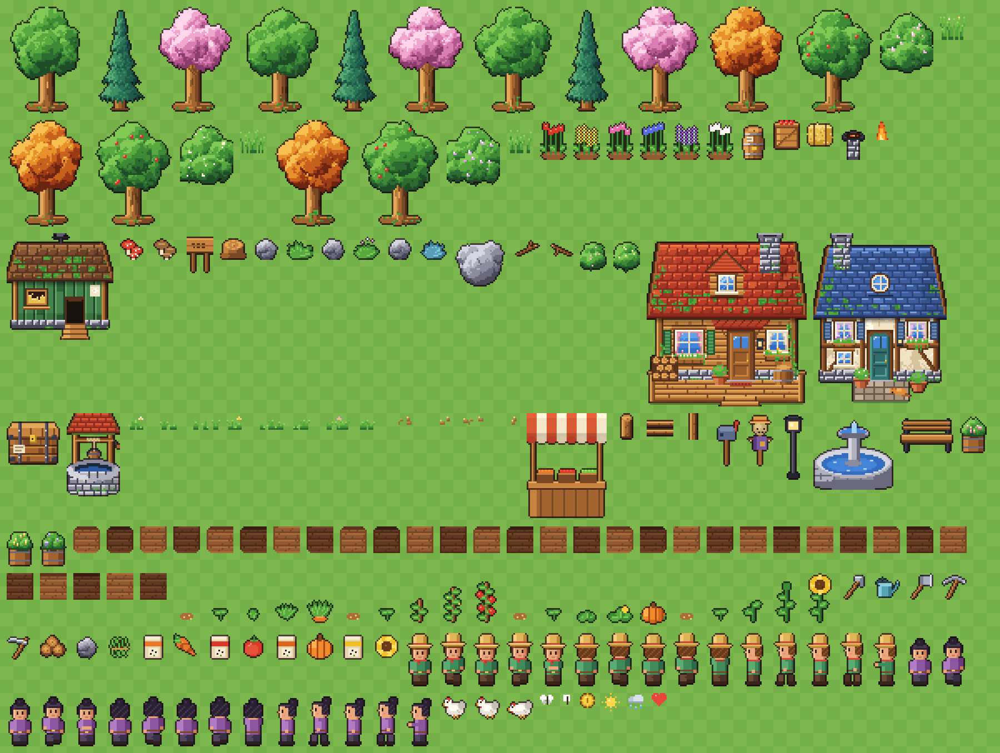

# Valle delle Lucciole

Gioco di fattoria 2.5D in pixel art, scritto in **Rust** con [macroquad](https://macroquad.rs).
Tutta la grafica (terreno, alberi, case, colture, personaggi, icone, font) è generata via codice:
non ci sono immagini esterne. Gli sprite vengono anche esportati in PNG in `assets/sprites/`.



## Avviare il gioco (Windows, macOS, Linux)

1. Installa Rust da <https://rustup.rs> (su Windows serve anche "Desktop development with C++" di Visual Studio Build Tools, che l'installer propone).
2. Da questa cartella:

```bash
cargo run --release
```

Il primo avvio compila tutto (circa un minuto). Poi parte in pochi secondi.

## Comandi

| Tasto | Azione |
|---|---|
| WASD / frecce | Muoviti (Shift per correre) |
| Clic sinistro / C / Spazio | Usa l'attrezzo o pianta i semi |
| Clic destro / E / X | Raccogli, apri la bancarella, usa la cassa, mangia |
| 1-0, rotella, Q / Tab | Cambia oggetto |
| H | Mostra i comandi |

## La mappa

- **La fattoria**: casa con patio in pietra, botti e cassette, pozzo, cassa delle spedizioni,
  pollaio con il recinto delle galline, orto recintato con bracieri all'ingresso e aiuole fiorite.
- **Lo stagno**: bordo di pietre, acqua turchese, ninfee, pontile in legno e una panchina.
- **Il frutteto** di meli e il **campo selvatico** da ripulire (erbacce, sassi, rami, erba alta).
- **Il prato a sud** con un laghetto naturale, canne, funghi e aceri autunnali.
- **Il paese** oltre il ponte, con la piazza, la fontana e la bancarella di Mira.
- Siepi fiorite e alberi fitti chiudono i bordi della mappa.

## Come si gioca

- **Zappa** il terreno, **pianta** i semi, **annaffia** ogni giorno: le colture crescono solo nei giorni bagnati.
- Riempi l'annaffiatoio al **pozzo** o allo **stagno**.
- **Ascia** per alberi, ceppi e rami; **piccone** per i sassi; **falce** per le erbacce (a volte trovi semi).
- Metti il raccolto nella **cassa** accanto a casa: lo paga di notte.
- Oltre il ponte c'è la piazza con la **bancarella di Mira** (aperta dalle 8:00 alle 20:00).
- Entra in **casa** per dormire: la partita si salva in `salvataggio.txt`. Dopo le 2:00 crolli dalla stanchezza.
- Il giorno passa con luce dell'alba, tramonto e notte; a volte piove (annaffia per te). Di sera si accendono le lucciole.

| Coltura | Giorni | Seme | Vendita |
|---|---|---|---|
| Carota | 4 | 20 | 38 |
| Pomodoro | 6 | 45 | 30 (2-4 frutti) |
| Girasole | 7 | 60 | 130 |
| Zucca | 9 | 110 | 340 |

## Come è fatto

| File | Contenuto |
|---|---|
| `src/sprites.rs` | Sprite dipinti pixel per pixel (luce dall'alto a sinistra, contorni selettivi) |
| `src/decor.rs` | Siepi, aceri, meli, staccionate, botti, fieno, bracieri, pollaio, aiuole, funghi, erba alta |
| `src/buildings.rs` | Case, pozzo e cassa costruiti a pezzi: tetti, assi, pietre, finestre, porte, dettagli |
| `src/world.rs` | Mappa, oggetti e "cottura" del terreno in una texture con bordi organici |
| `src/render.rs` | Rendering 2.5D: ordinamento per profondità, ombre, trasparenza dietro alberi e tetti, luci notturne |
| `src/game.rs` | Logica: attrezzi, colture, giorni, negozio, salvataggio |
| `src/ui.rs`, `src/font.rs` | Interfaccia e font bitmap 5x7 |

Ogni oggetto proietta un'ombra che segue il sole (lunga a ovest al mattino, corta a mezzogiorno, lunga a est la sera),
le nuvole fanno ombra mentre passano e la luce cambia colore durante il giorno (alba rosata, mezzogiorno neutro,
ora dorata, notte blu). La base di alberi, case, pozzo e cassa si fonde con il terreno grazie a ciuffi d'erba
o sassolini scelti in base al suolo su cui poggiano.

Il mondo viene disegnato a bassa risoluzione (circa 480x270) e ingrandito a scala intera, così i pixel restano nitidi.
Di notte una mappa di luce viene moltiplicata sulla scena (finestre, lampioni, lucciole).

### Strumenti per sviluppatori

```bash
cargo run --release -- --export-art
```

Riesporta tutti gli sprite in `assets/sprites/`.

```bash
VALLE_SHOT=prova.png,40,selftest cargo run --release
```

Esegue un test automatico del ciclo di gioco (zappa, semina, crescita, raccolto, vendita, alberi, negozio, salvataggio).

### Versione web

```bash
rustup target add wasm32-unknown-unknown
cargo build --release --target wasm32-unknown-unknown
cp target/wasm32-unknown-unknown/release/valle-lucciole.wasm web/
```

Poi servi la cartella `web/` con un server qualsiasi (es. `python -m http.server`) e apri `index.html`.
Nella versione web il salvataggio non è disponibile.
